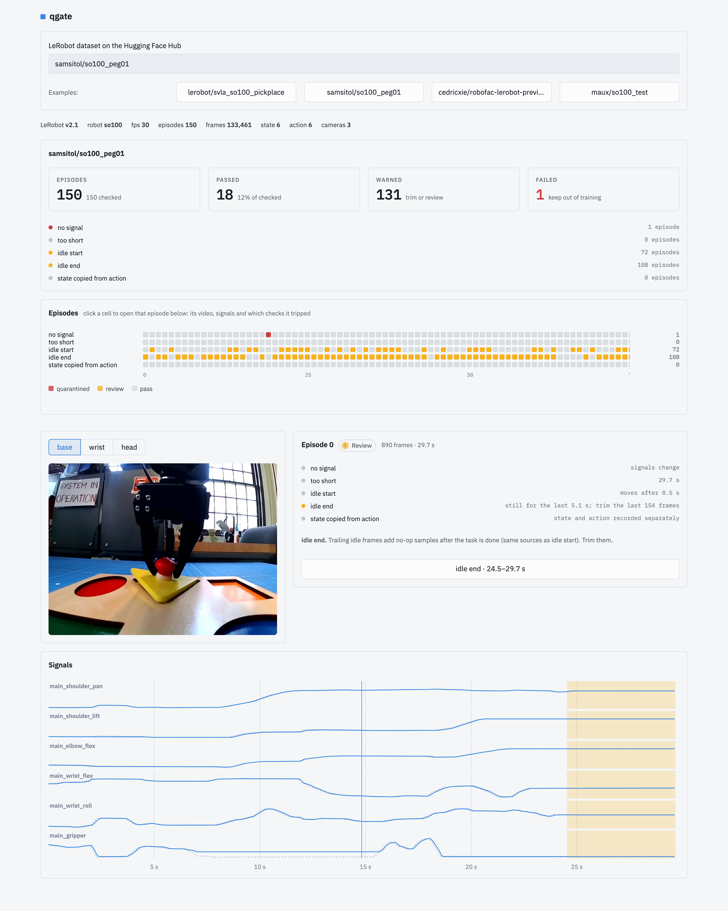

# robot-data-quality-gate

A quality gate for robot manipulation data. Enter any public LeRobot dataset on the Hugging Face Hub (v2.0, v2.1 or v3.0). It checks every episode, gives each a **pass / warn / fail** verdict, and lets you open any episode to see its video, its state and action signals, and the stretches the checks flagged.

## The app

**Live at [dataqualitygate.streamlit.app](https://dataqualitygate.streamlit.app)**

Enter a dataset (`owner/name`) or pick an example. Episodes are read straight from the Hub. Only the state and action columns are loaded into memory, and nothing is written to disk. Large datasets are checked on an evenly spaced sample unless you ask for every episode.

- **Dataset verdict:** how many episodes passed, warned and failed, and how many tripped each check. A check that fires in every episode is treated as how the dataset was recorded, not as a fault.
- **Episode grid:** one square per episode per check. Click a square to open that episode.
- **Episode view:** the video, with buttons that jump to each flagged stretch. Below it, the state (solid) and commanded action (dotted) signals, with the flagged stretches shaded.

### Checks

| Check | Verdict |
|---|---|
| No signal: state or action never changes | fail |
| Episode under 1 s | fail |
| Robot still for over 3 s at the start, with the frames to trim | warn |
| Robot still for over 3 s at the end, with the frames to trim | warn |
| State copied from action | fail |

Every check runs on every episode, even one where nothing moves. Such an episode also counts as still at the start and end, and if its state and action are equal (all zeros, say) it counts as state copied from action.
