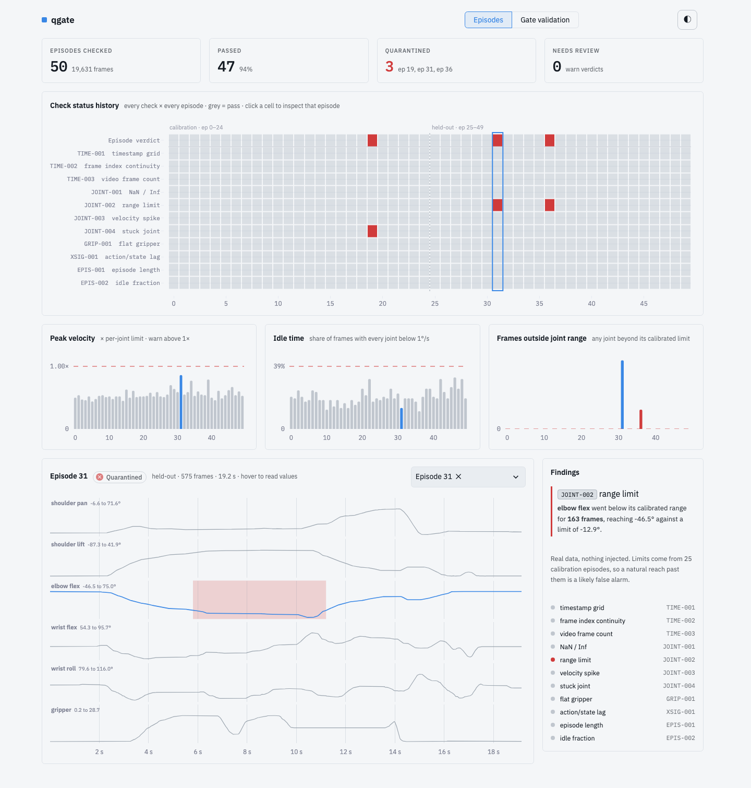

# robot-data-quality-gate

An ingestion-time quality gate for robot manipulation data. It checks every episode of a LeRobot-format dataset, gives it a **pass / warn / fail** verdict with stable taxonomy codes, and **proves it works** by injecting known faults into copies of real episodes and scoring what it catches and what it misses.

Built on the real [`lerobot/svla_so100_pickplace`](https://huggingface.co/datasets/lerobot/svla_so100_pickplace) dataset (50 episodes, 19,631 frames, SO-100 arm, Apache-2.0).



<!-- TODO: hosted app link + 90 s video link -->

## Results

Thresholds are calibrated on episodes 0-24. Faults are injected into copies of held-out episodes (25-49) that pass clean, 10 episodes per cell, fixed seed. Each cell reads `detected/attributed of N`: *detected* means the injected copy was not a pass; *attributed* means one of the expected taxonomy codes was among the findings.

| Fault | Subtle | Moderate | Obvious |
|---|---|---|---|
| timestamp_jitter | 10/10 of 10 (`0.1` ms sigma) | 10/10 of 10 (`0.5` ms sigma) | 10/10 of 10 (`2.0` ms sigma) |
| dropped_frames | 10/10 of 10 (`1` frames) | 10/10 of 10 (`5` frames) | 10/10 of 10 (`20` frames) |
| duplicated_rows | 10/10 of 10 (`1` rows) | 10/10 of 10 (`5` rows) | 10/10 of 10 (`20` rows) |
| non_monotonic_ts | 10/10 of 10 (`1` swaps) | 10/10 of 10 (`3` swaps) | 10/10 of 10 (`10` swaps) |
| clock_drift | 10/10 of 10 (`1e-05` scale error) | 10/10 of 10 (`0.0001` scale error) | 10/10 of 10 (`0.001` scale error) |
| velocity_spike | 0/0 of 10 (`1.5` x p99.9) | 10/10 of 10 (`3.0` x p99.9) | 10/10 of 10 (`10.0` x p99.9) |
| range_violation | 10/10 of 10 (`0.01` span beyond limit) | 10/10 of 10 (`0.05` span beyond limit) | 10/10 of 10 (`0.3` span beyond limit) |
| stuck_joint | 7/0 of 10 (`30` frames) | 10/10 of 10 (`90` frames) | 10/10 of 10 (`200` frames) |
| nan_values | 10/10 of 10 (`1` samples) | 10/10 of 10 (`5` samples) | 10/10 of 10 (`20` samples) |
| gripper_flat | 0/0 of 10 (`0.5` amplitude kept) | 7/7 of 10 (`0.2` amplitude kept) | 10/10 of 10 (`0.0` amplitude kept) |
| action_state_lag | 0/0 of 10 (`2` extra frames) | 10/10 of 10 (`5` extra frames) | 10/10 of 10 (`10` extra frames) |
| truncation | 10/10 of 10 (`0.01` fraction cut) | 10/10 of 10 (`0.05` fraction cut) | 10/10 of 10 (`0.25` fraction cut) |
| idle_padding | 1/1 of 10 (`60` frames) | 9/9 of 10 (`150` frames) | 10/10 of 10 (`300` frames) |

**False positives on the clean held-out episodes (25):**

- Flagged (warn or fail): **2/25** (95% CI 2%-25%)
- Failed (quarantined): **2/25** (95% CI 2%-25%)
  - episode 31: fail (JOINT-002)
  - episode 36: fail (JOINT-002)

Where it misses is as informative as where it hits: a velocity spike at 1.5x the normal p99.9 velocity, a gripper at half amplitude, and a 2-frame action/state lag all slip through at *subtle* severity, by design of the thresholds. A 30-frame frozen joint is flagged, but under the wrong code (the stuck-joint window is 60 frames; the velocity check catches the jump when the joint unfreezes).

## Quickstart

```bash
pip install -e ".[dev]"            # numpy, pandas, pyarrow, huggingface_hub
python scripts/fetch_data.py data/so100          # metadata + parquet only, a few MB; no video
qgate check data/so100                           # exit code 1 if any episode fails
qgate bench data/so100                           # rerun the fault-injection benchmark
pip install -e ".[app]" && python scripts/build_app_data.py data/so100
python scripts/build_clips.py data/so100         # per-episode H.264 clips for the Live page (needs the videos + ffmpeg)
streamlit run app/app.py                         # dashboard
pytest                                           # unit tests
```

## How it works

- **11 checks, each with a stable code** (`TIME-001` timestamp grid, `TIME-002` frame-index continuity, `TIME-003` video frame count vs rows, `JOINT-001` NaN/Inf, `JOINT-002` range, `JOINT-003` velocity spike, `JOINT-004` stuck joint, `GRIP-001` flat gripper, `XSIG-001` action/state lag, `EPIS-001` length, `EPIS-002` idle fraction).
- **Verdicts:** structural violations (timestamps, NaN, range, frame counts, extreme velocity, stuck joints, flat gripper) **fail** = quarantine; statistical ones (velocity above limit, lag, length, idle) **warn** = human review. An episode takes its worst verdict.
- **Thresholds come from the data**, not guesses: robust percentiles from a clean calibration set with a margin. Every threshold records whether it is sourced from the literature, derived from the data, or my own choice (see the dashboard's *Thresholds & codes* tab or `thresholds.json`).
- **13 faults x 3 severities** (`bench/inject.py`): timestamp jitter, dropped frames, duplicated rows, non-monotonic timestamps, clock drift, velocity spike, range violation, stuck joint, NaN values, flat gripper, action/state lag, truncation, idle padding. Injection works on copies, never the originals.
- **Live replay** (`qgate/live.py`, dashboard *Live* page): episodes are streamed frame by frame at 30 fps against the episode's video from the Hub, optionally with injected faults. The gate raises a finding on the frame where it becomes true (e.g. episode 36's range violation at 2.5 s of 14.7 s) at about 0.2 ms per frame; video count, lag, idle and short-episode checks wait for the episode to end. The final streamed verdict equals the batch verdict (`tests/test_live.py`).
- **Any dataset** (`qgate/hub.py`, dashboard *Any dataset* page): type any public LeRobot dataset (v2.0, v2.1 or v3.0) and stream one of its episodes straight from the Hub, with its video. Only that episode's state/action columns are read into memory; nothing is saved. Five checks run there, chosen because they need no calibrated thresholds, use only state and action, and each caught real faults when replayed over 7,792 episodes from 37 Hub datasets (`tickets/T8-research-state-action-checks.md`): `JOINT-005` no signal (31 episodes, e.g. robofac's placeholder zeros), `EPIS-003` under 1 s (7), `EPIS-004` / `EPIS-005` robot still for over 3 s at the start / end, with the frames to trim (612 / 488), and `XSIG-002` state copied from action (32 robofac sim episodes). The timestamp, frame-index and NaN checks never fired on real Hub data, so they are not shown there.
- **Dashboard** (`app/app.py`): four pages. *Episodes* shows verdict counts, a check × episode status history, how close each episode came to the velocity, idle and range thresholds, and an inspector that shades flagged frames and explains each finding in plain language. *Gate validation* shows the benchmark heatmap, where the gate falls short, false positives, and a *Fault lab* that injects a fault into a real episode and runs the gate live. Colour is used only for problems; light and dark themes are set in `.streamlit/config.toml`.

## What I'm unsure about

- **Few thresholds have a primary source.** Only the timestamp tolerance (LeRobot's `tolerance_s`, 1e-4 s) and the episode rules borrowed in spirit from UMI are sourced. Velocity, range, gripper, idle and lag thresholds are data-derived from 25 episodes, so they are noisy. The benchmark's confidence intervals are wide for the same reason.
- **Timing faults look easier than they are.** This dataset's timestamps sit exactly on the 1/fps grid (worst deviation under 1e-6 s), so a 1e-4 s tolerance catches even 0.1 ms of jitter in every episode. Real collection hardware will not be this clean.
- **Natural outliers.** Episodes 31 and 36 trip the range check and episode 19 trips the stuck-joint check on the unmodified data. I report these as false positives, not hide them.
- **A "session" is a block of 10 consecutive episodes.** Public data has no real collection sessions; the trend chart is a stand-in for how this would track drift as collection scales.
- **Injected faults are synthetic.** Faults are injected in memory into arrays loaded from the parquet files, not into the files or the video; video-level faults are not tested.

## Next steps / not built

- Versioned schema design and migration across collection modalities.
- Tracing quality issues back to operators and hardware (calibration, sensor drift).
- Camera-pose and tracking-loss checks for UMI-style data; frozen/black video frames.
- Running on a second real dataset (`droid_100`) to show findings on genuinely messy data.
- Ingestion at warehouse scale.
